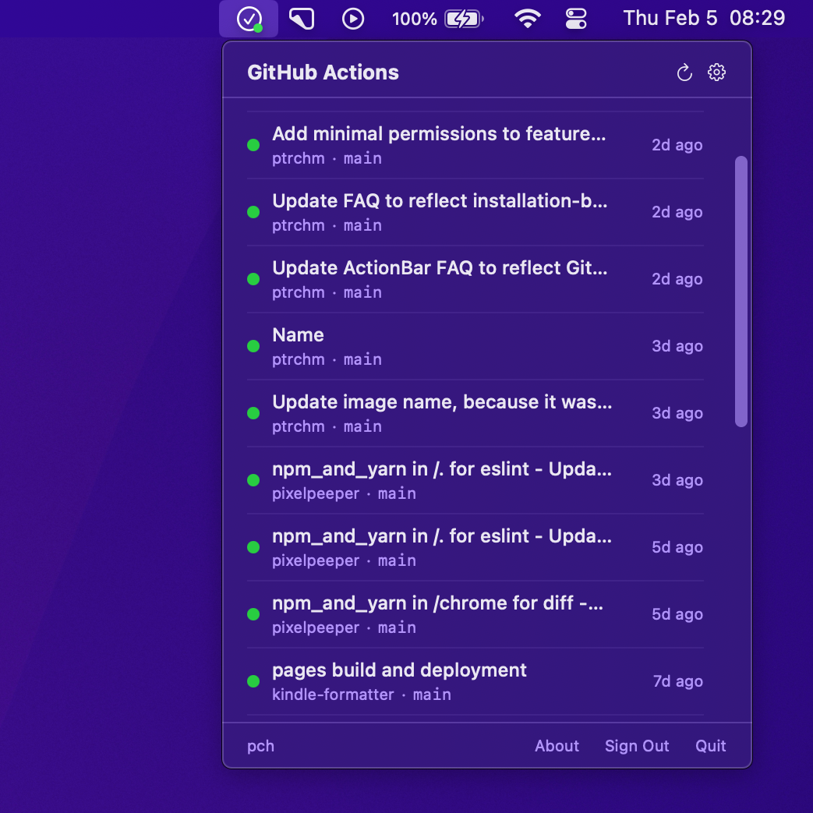

# ActionBar

Monitor your GitHub Actions workflow runs directly from the macOS menu bar.

<p align="center">
  
</p>

<p align="center">
  <a href="https://github.com/pch/actionbar/releases/latest/download/ActionBar.dmg">Download</a> ·
  <a href="https://ptrchm.com/actionbar/">Website</a>
</p>

## Features

- See workflow run statuses at a glance
- Get notifications when runs complete
- Select the repositories you want to monitor
- Minimal permissions — no access to your code
- Native macOS app — lightweight and fast
- Automatic updates via [Sparkle](https://sparkle-project.org)

## How it works

ActionBar signs in through a [GitHub App](https://github.com/apps/actionbar-macos) using the OAuth device flow. The app only has **Actions (read)** and **Metadata (read)** permissions, so it never has access to your code. It only calls the [workflow runs API](https://docs.github.com/en/rest/actions/workflow-runs) (`/repos/{owner}/{repo}/actions/runs`) for the repositories you select.

Your access token is stored in the macOS Keychain.

By default, ActionBar polls the API every 30 seconds; the interval is configurable, and you can refresh manually at any time. Each monitored repository requires a separate API call on every refresh, so monitoring a large number of repositories may hit GitHub's rate limits.

## Privacy

ActionBar does not collect, transmit, or share any personal data. The app only talks to GitHub: the official API (`api.github.com`) and, for update checks, this repository's releases. No analytics, telemetry, or third-party services are used. All stored data is deleted when you sign out.

## Building from source

Requirements: macOS 14+ and a recent version of Xcode.

1. Clone the repository.
2. Copy `Config/Local.xcconfig.example` to `Config/Local.xcconfig` and set your Apple Developer Team ID and a bundle identifier registered to your team.
3. Open `ActionBar.xcodeproj` and run the `ActionBar` scheme, or use `make run`.

The app authenticates through the official ActionBar GitHub App. If you're shipping your own fork, register your own [GitHub App](https://docs.github.com/en/apps/creating-github-apps) with device flow enabled and **Actions (read)** permission, then update `GitHubApp.clientID` and `GitHubApp.installationURL` in `Sources/ActionBar/Services/OAuthService.swift`. You'll also need your own Sparkle key pair and feed URL in `Resources/Info.plist` (see below).

## Releasing

Releases are built, signed, notarized and published by the [Release workflow](.github/workflows/release.yml) when a version tag is pushed. First add a `## <version>` section to [CHANGELOG.md](CHANGELOG.md); it becomes the release notes on GitHub and in the update dialog. Then tag:

```sh
git tag v2.0
git push origin v2.0
```

The workflow produces a notarized `ActionBar.dmg` and a Sparkle `appcast.xml`, and attaches both to a GitHub Release. The app checks `releases/latest/download/appcast.xml` for updates. The build number is the commit count, so it always increases.

It needs these repository secrets:

| Secret | Value |
| --- | --- |
| `DEVELOPER_ID_CERT_P12` | "Developer ID Application" certificate exported from Keychain Access as `.p12`, base64-encoded |
| `DEVELOPER_ID_CERT_PASSWORD` | Password for the `.p12` |
| `APPLE_ID` | Apple ID email used for notarization |
| `APPLE_APP_PASSWORD` | [App-specific password](https://support.apple.com/en-us/102654) for that Apple ID |
| `APPLE_TEAM_ID` | Apple Developer Team ID |
| `SPARKLE_PRIVATE_KEY` | Sparkle EdDSA private key (`generate_keys --account actionbar -x key.txt`) |

## License

The source code is released under the [MIT License](LICENSE).

The ActionBar name and app icon are not covered by the license. If you distribute a fork, please use a different name and icon.

ActionBar is an independent project and is not affiliated with GitHub.
